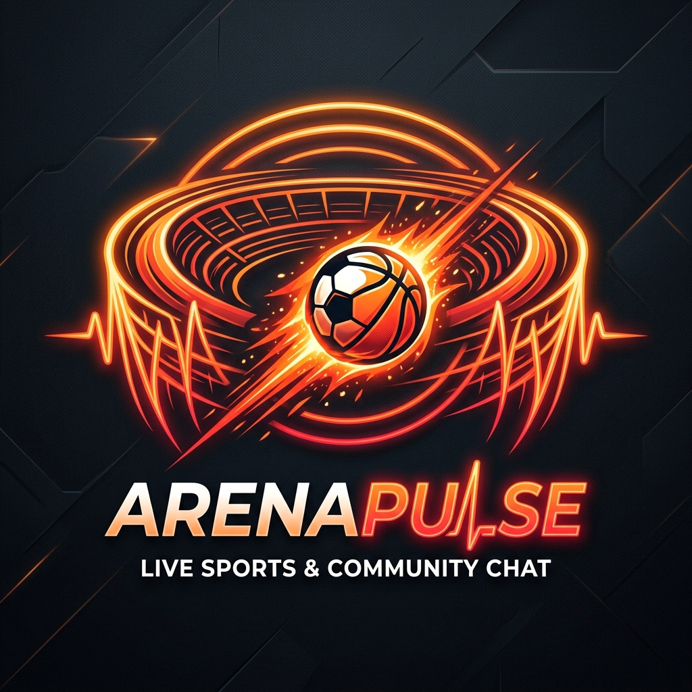
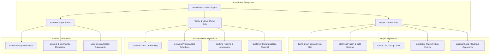
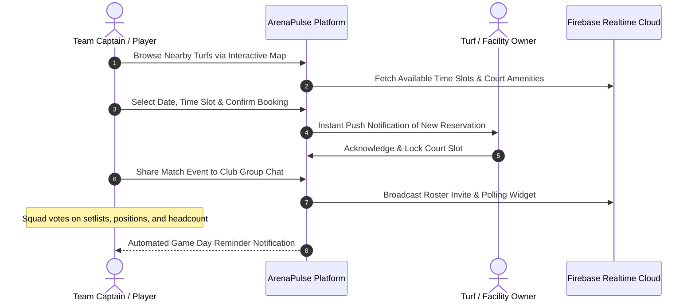

<div align="center">

<p align="center">
  
</p>

# ArenaPulse

### Sports Turf & Court Reservation, Athletic Club Hub & Team Matchmaking Ecosystem

[](https://flutter.dev)
[](https://dart.dev)
[](https://firebase.google.com)
[](https://cloud.google.com/maps-platform)
[](LICENSE)

<p align="center">
  <b>ArenaPulse</b> is a modern, cross-platform sports networking and venue booking ecosystem designed for recreational athletes, local sports clubs, and facility owners. Seamlessly coordinate turf bookings, join neighborhood teams, vote in match polls, and coordinate game days in real time.
</p>

</div>

---

## 🌟 Platform Capabilities

ArenaPulse addresses the friction of organizing casual and competitive sports games by uniting facility scheduling with community matchmaking:



---

## ⚽ Booking & Match Coordination Flow



---

## ✨ Core Features

### 🏟️ 1. Venue & Slot Booking
- **Dual Map Support:** Integrated Google Maps and OpenStreetMap (OSM) for seamless global and local location discovery.
- **Granular Scheduling:** Reserve cricket pitches, football turfs, padel courts, tennis courts, and basketball arenas by the hour.
- **Dynamic Slot States:** Real-time visibility into open, held, and confirmed reservations to eliminate double-booking.

### 💬 2. Community & Club Hub
- **Sports Clubs:** Create public or private sports clubs (e.g. "Downtown Futsal Club", "Sunday Morning Cricket").
- **Real-Time Group Chat:** Instant messaging with media sharing, match coordination, and push notifications.
- **Interactive Match Polls:** Create headcounts and RSVP polls to finalize player rosters before match day.

### 🛡️ 3. Safety, Security & Admin
- **Community Moderation:** Built-in reporting and user blocking mechanisms with admin review tools.
- **Facility Owner Dashboard:** View earnings, peak hour utilization, and booking history in a dedicated owner view.
- **Cross-Platform Support:** Native experience across iOS, Android, Web, macOS, Linux, and Windows.

---

## 📁 Repository Structure

```
ArenaPulse/
├── assets/
│   └── branding/
│       └── logo.png               # Official brand asset
├── backend/                       # PHP media upload & storage service
├── functions/                     # Firebase Cloud Functions (Push notifications, auto-cleanup)
├── lib/
│   ├── main.dart                  # Application bootstrap
│   ├── firebase_options.dart      # Multi-platform Firebase configuration
│   └── src/
│       ├── screens/               # 38+ Application Screens (Book slot, club profile, maps)
│       ├── services/              # 28+ Business Services (Auth, bookings, clubs, locations)
│       ├── tabs/                  # Feed tabs (Polls, events, media posts, comments)
│       ├── utils/                 # Engagement & calculation helpers
│       └── widgets/               # Turn-by-turn overlay, dialogs, bottom nav
├── test/                          # Unit and widget test suite
├── firestore.rules                # Hardened Firestore security rules
└── README.md
```

---

## 🚀 Getting Started

### Prerequisites
- **Flutter SDK:** `>= 3.9.0`
- **Firebase Project:** (Authentication, Firestore, Cloud Messaging, Storage)
- **Google Maps API Key:** (Optional for Google Maps rendering; OSM works out of the box)

### Quick Start
```bash
# Clone the repository
git clone https://github.com/itismemuhammadali/ArenaPulse.git
cd ArenaPulse

# Install dependencies
flutter pub get

# Launch on connected mobile device or simulator
flutter run
```

---

## 🔒 Confidentiality & White-Label Notice
This repository is an open-source demonstration and portfolio showcase. All proprietary client data, commercial vendor contracts, live API tokens, and client credentials have been sanitized and decoupled.

---

## 👨‍💻 Author
**Muhammad Ali**
- GitHub: [@itismemuhammadali](https://github.com/itismemuhammadali)
- Portfolio & Engineering Showcase
